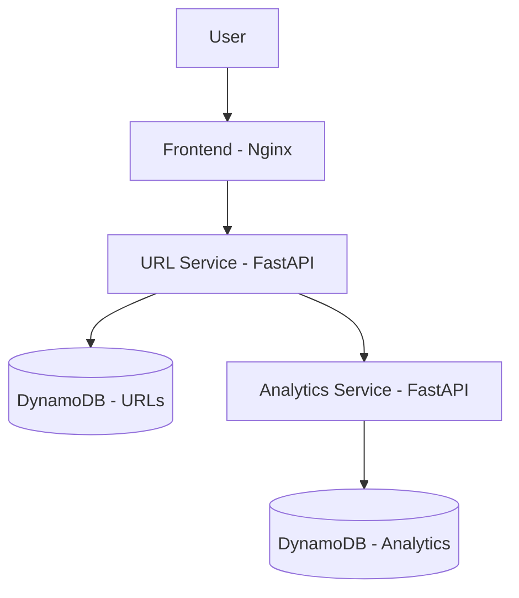
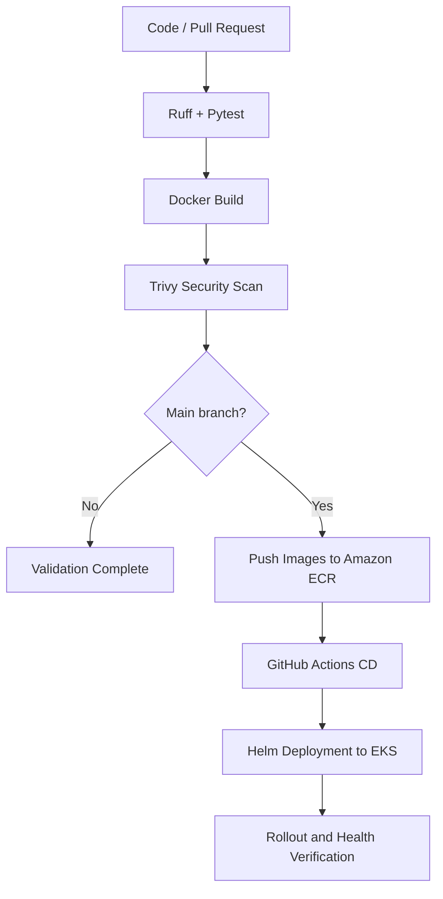

# URL Shortener

A cloud-native URL shortening application built with Python, FastAPI, and Nginx. It allows users to generate short links, redirect to original URLs, and track link usage through a simple web interface.

The application follows a microservices architecture, with automated CI/CD, containerized deployments on Amazon EKS, and monitoring through AWS CloudWatch.

## 1. Application Overview

The application provides three main capabilities:

- **URL shortening:** Generate a unique short link from an original URL.
- **Redirection:** Redirect visitors to the original destination.
- **Analytics:** Track the number of visits to each shortened URL.

A lightweight web interface communicates with REST APIs to manage URLs and retrieve analytics.

## 2. Application Architecture

The application consists of three independently containerized services:

| Service | Technology | Responsibility |
|---|---|---|
| Frontend | Nginx, HTML, CSS, JavaScript | Web interface and reverse proxy |
| URL Service | Python, FastAPI | URL creation, lookup, and redirection |
| Analytics Service | Python, FastAPI | Redirect tracking and click counters |

Services communicate over internal HTTP endpoints. DynamoDB stores URL mappings and analytics data in separate tables.

Analytics is designed as a non-critical dependency: if the Analytics Service becomes unavailable, URL redirection continues to function, although some click events may not be recorded.

All services run in Docker containers and can be started locally using Docker Compose.

## 3. CI/CD Pipeline

The delivery process combines automated testing, security scanning, image publishing, and Kubernetes deployment.

Test-driven development (TDD) was applied selectively when implementing the backend services. Automated tests are executed continuously through GitHub Actions.

The pipeline includes:

- **Code quality:** Ruff linting and automated tests with Pytest.
- **Containerization:** Docker builds for the three services.
- **Security:** Trivy scans container images for vulnerabilities before publishing.
- **Artifact management:** Docker images are stored in Amazon ECR using immutable Git commit SHA tags.
- **Authentication:** GitHub Actions uses AWS OIDC instead of long-lived access keys.
- **Deployment:** Helm manages Kubernetes releases on Amazon EKS, with rollout and health verification.

Pull requests undergo validation, while successful changes merged into `main` trigger image publishing and deployment to the non-production environment.

## 4. AWS Infrastructure

AWS infrastructure is provisioned using Terraform, with remote state stored in Amazon S3.

| AWS Service | Purpose |
|---|---|
| VPC | Network isolation across two Availability Zones |
| Public subnets | Internet-facing Application Load Balancer and NAT Gateway |
| Private subnets | EKS worker nodes and application workloads |
| Amazon EKS | Kubernetes orchestration |
| Amazon ECR | Private Docker image repositories |
| Amazon DynamoDB | URL mappings and analytics storage |
| Application Load Balancer | Public entry point and HTTP routing |
| Amazon CloudWatch | Logs, metrics, and alarms |
| Amazon SNS | Email alert notifications |
| Amazon S3 | Remote Terraform state |

The public Application Load Balancer routes requests to the frontend running inside EKS. Backend services communicate internally through Kubernetes Services.

Application workloads run in private subnets, while EKS Pod Identity provides AWS access to backend services using dedicated IAM roles and least-privilege permissions.

DynamoDB uses on-demand capacity to accommodate variable traffic without managing database servers.

## 5. Monitoring, Alerting & Reliability

The platform includes observability and reliability mechanisms to support application operations.

**Monitoring and alerting**
- CloudWatch collects application logs and infrastructure metrics.
- CloudWatch alarms monitor conditions such as ALB errors, unhealthy targets, and DynamoDB throttling.
- Amazon SNS delivers email notifications when configured alarm thresholds are reached.

**Availability and scalability**
- Kubernetes readiness and liveness probes monitor container health.
- Resource requests and limits help manage CPU and memory consumption.
- Horizontal Pod Autoscaler (HPA) adjusts application replica counts based on CPU utilization.
- Kubernetes Deployments recreate failed Pods and support controlled rolling updates.

**Reliability validation**
- Controlled load tests evaluate application performance and scaling behavior.
- Failure testing verifies that redirects remain available during Analytics Service outages.
- Kubernetes rollout and health checks validate deployments before considering them successful.

The architecture prioritizes the availability of URL redirection, even when non-critical analytics functionality is degraded.
